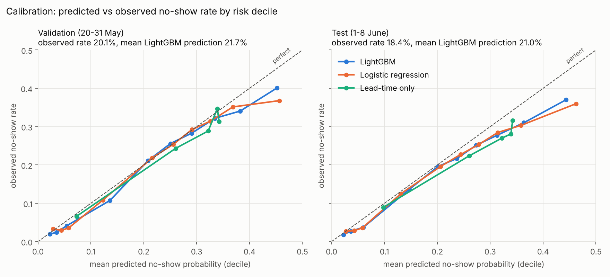
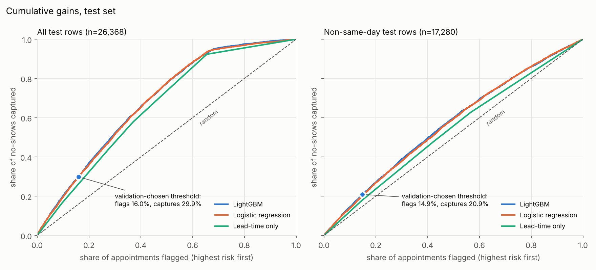
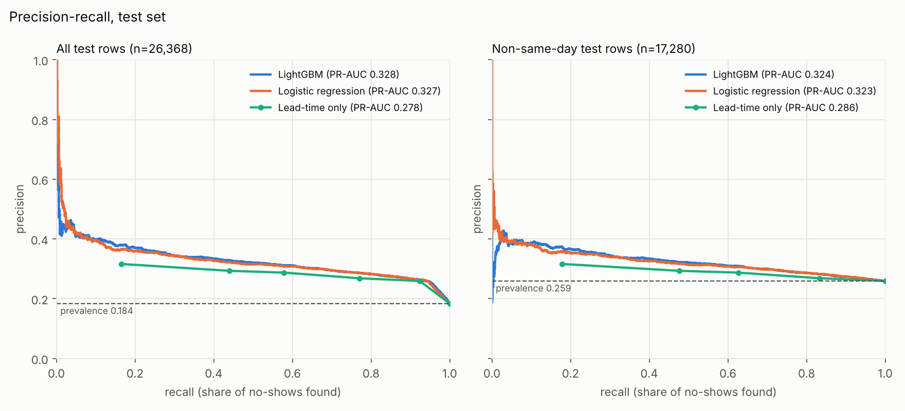
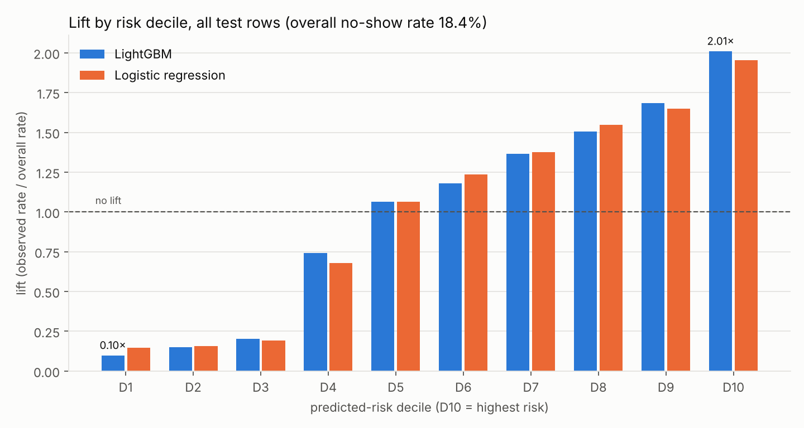
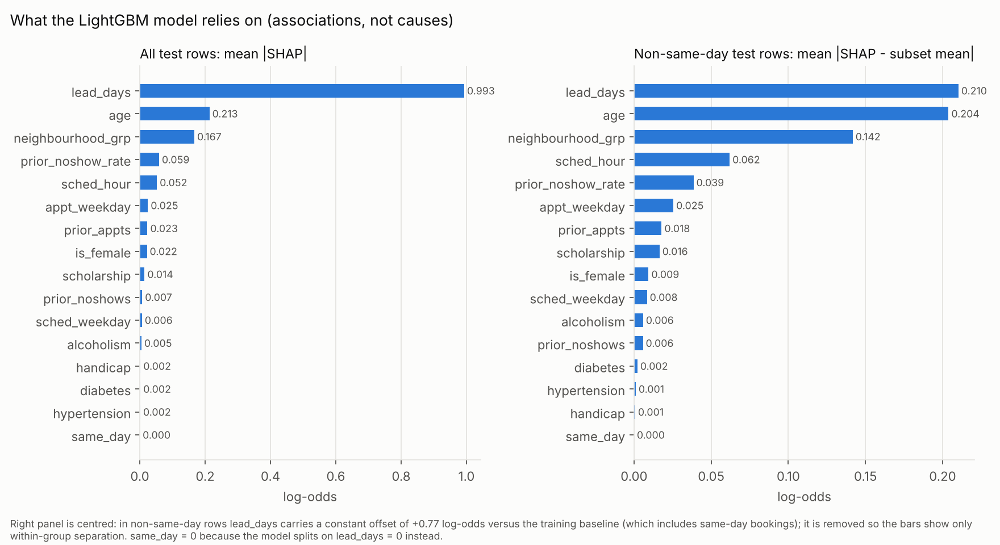
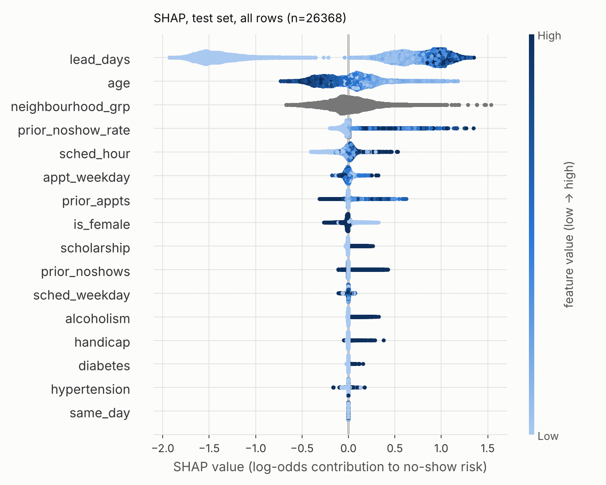
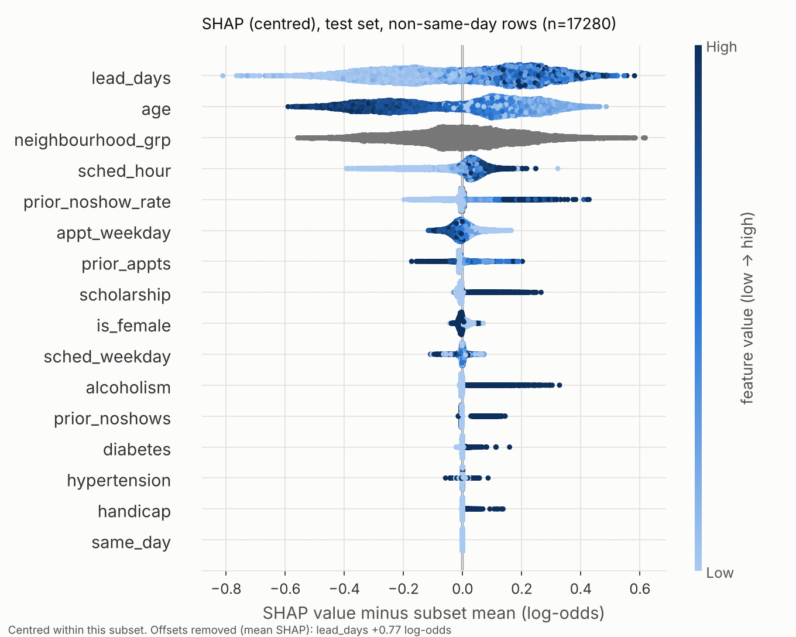

<!-- GENERATED FILE: edit docs/README.template.md, then run `python scripts/build_readme.py`.
     Every number below is read from results/*.json; tests/test_readme_drift.py fails if this file drifts. -->

# Appointment no-show predictor: time-split, leakage-checked, with SHAP

Predicts, **at the moment an appointment is booked**, whether the patient will not attend. The project uses the public Kaggle *Medical Appointment No Shows* data and includes:

- a time-based split;
- three baselines and LightGBM, with no hyperparameter search;
- a test set evaluated once (1 logged run in `results/test_runs.log`);
- SHAP explanations;
- a descriptive Power BI dashboard recipe.

> **Bottom line, stated plainly.** LightGBM is **tied with logistic regression**: the paired test difference is +0.003 ROC-AUC, 95% CI [-0.002, +0.008].
> Most of the signal is **lead time** (same-day vs booked ahead). Among appointments booked at least a day ahead, test ROC-AUC is only **0.59**.
> Predictions run 1.6 pts (validation) and 2.6 pts (test) above the observed no-show rate. The no-show rate and the lead-time mix shift over the six weeks, and no recalibration was applied.
> The data comes from **one Brazilian city over six weeks**.

## Headline results (test set: appointments 1–8 June 2016)

ROC-AUC and PR-AUC are shown with equal weight for **all rows** and for **non-same-day rows**. PR-AUC here means **scikit-learn `average_precision_score`** (step-wise average precision), not the trapezoidal area. Brackets are 95% intervals from a patient-clustered bootstrap with 500 resamples.

| Model | All rows ROC-AUC | All rows PR-AUC | Non-same-day ROC-AUC | Non-same-day PR-AUC |
|---|---|---|---|---|
| Rows / no-show rate | 26,368 / 18.4% | | 17,280 / 25.9% | |
| Prevalence (constant) | 0.500 | 0.184 | 0.500 | 0.259 |
| Lead-time only | 0.691 [0.684–0.699] | 0.278 [0.269–0.287] | 0.549 [0.538–0.558] | 0.286 [0.276–0.295] |
| Logistic regression | 0.722 [0.714–0.730] | 0.327 [0.312–0.342] | 0.587 [0.577–0.598] | 0.323 [0.311–0.336] |
| **LightGBM** | **0.725** [0.717–0.733] | **0.328** [0.314–0.344] | **0.590** [0.580–0.600] | **0.324** [0.313–0.337] |

**LightGBM vs logistic regression** (paired, patient-clustered bootstrap on test):

| Rows | ROC-AUC difference | 95% CI | PR-AUC difference | 95% CI |
|---|---|---|---|---|
| All rows | +0.0031 | [-0.0018, +0.0081] | +0.0016 | [-0.0097, +0.0125] |
| Non-same-day | +0.0029 | [-0.0055, +0.0105] | +0.0008 | [-0.0091, +0.0110] |

Every interval includes zero: **the two models are tied.**

**Validation set (20–31 May), same models:**

| Model | ROC-AUC (all rows) | PR-AUC (all rows) | ROC-AUC (non-same-day) | PR-AUC (non-same-day) |
|---|---|---|---|---|
| LightGBM | 0.739 | 0.360 | 0.597 | 0.362 |
| Logistic regression | 0.729 | 0.350 | 0.583 | 0.350 |

### Calibration

| Measure (LightGBM, test) | Value |
|---|---|
| Brier score | 0.1370 |
| Calibration slope | 0.98 |
| Calibration intercept | -0.21 |
| Expected calibration error (deciles) | 0.026 |
| Mean prediction vs observed rate | 21.0% vs 18.4% |

Predictions run 1.6 pts (validation) and 2.6 pts (test) above the observed rate. The no-show rate (train 20.8% → test 18.4%) and the lead-time mix shift over the six weeks. **No recalibration was applied.**



### Flagging the top 20% by risk

The cutoff is the 80th percentile of **validation** scores (LightGBM: 0.358). It was applied unchanged to test:

| Result on test | Value |
|---|---|
| Share of appointments flagged | **16.0%** (not 20%, because test has fewer no-shows) |
| Share of no-shows captured | **29.9%** |
| Precision among flagged | 34.3% |
| Lift over the base rate | 1.86× |

On non-same-day rows, with a threshold chosen on validation non-same-day rows, it flags 14.9% and captures 20.9% of no-shows.

The highest-risk tenth has 2.01× the base rate; the lowest tenth has 0.10×.





### Sensitivity runs (LightGBM, test)

| Run | ROC-AUC (all rows) | PR-AUC (all rows) | ROC-AUC (non-same-day) | PR-AUC (non-same-day) |
|---|---|---|---|---|
| Main model | 0.725 | 0.328 | 0.590 | 0.324 |
| Without patient-history features | 0.721 | 0.323 | 0.589 | 0.325 |
| Duplicates kept (own test set, n=26,449) | 0.725 | 0.328 | 0.592 | 0.326 |
| Patients seen in training (46.1% of test rows) | 0.709 | 0.349 | 0.594 | 0.339 |
| Patients not seen in training (53.9%) | 0.738 | 0.304 | 0.586 | 0.310 |

- **History features add little.** One reason: history is cut off at the start of the data window, so the share of rows with any history rises from 18% in train to 45% in test.
- **Duplicates don't change the result.**
- **No sign of memorising patients.** On all rows, patients seen in training score *lower* ROC-AUC (0.709 vs 0.738). On non-same-day rows the two are close (0.594 vs 0.586). Their higher PR-AUC follows their higher no-show rate (20.3% vs 16.8%).

### Post-hoc subgroup: same-day bookings (hypothesis only)

This subgroup was examined **after** the final run, from saved predictions, and was not part of the pre-declared evaluation.

Same-day bookings are 34.5% of test rows, with a no-show rate of 4.1%.

| Subgroup | n | LightGBM ROC-AUC | Logistic regression ROC-AUC | Paired difference (LightGBM − LR), 95% CI |
|---|---|---|---|---|
| Test, same-day | 9,088 | **0.70** [0.67–0.74] | 0.66 | ROC-AUC [+0.017, +0.066]; PR-AUC [-0.038, +0.040] |
| Validation, same-day | 7,318 | **0.70** [0.66–0.73] | 0.62 | ROC-AUC [+0.045, +0.110]; PR-AUC [-0.023, +0.041] |

**Why same-day rows can be ranked at all is a hypothesis, not a finding.** One idea is that some "same-day" rows are walk-ins registered on arrival, with booking hour acting as a proxy. The model's attributions do **not** support booking hour as the driver: within same-day test rows its centred mean |SHAP| is 0.038. The larger contributions are:

- age: 0.235
- neighbourhood: 0.215
- prior no-show rate: 0.119

The walk-in idea is untested. In this subgroup only, LightGBM ranks better than logistic regression on ROC-AUC, though not on PR-AUC. That is a post-hoc result and does not change the overall tie.

## SHAP: what the model uses (not what causes no-shows)

SHAP values describe the **frozen LightGBM's** reliance on each feature. They are associations inside a predictive model, **not causal effects**. Checks run on 46,803 validation and test rows:

- SHAP values plus the base value equal the model's log-odds output to within 8.4e-15;
- TreeExplainer matches LightGBM's own `pred_contrib`;
- the model reproduces the saved predictions.

| Feature | Mean \|SHAP\|, all test rows | Mean \|SHAP − subset mean\|, non-same-day test rows |
|---|---|---|
| lead_days | 0.993 | 0.210 |
| age | 0.213 | 0.204 |
| neighbourhood | 0.167 | 0.142 |
| booking hour | 0.052 | 0.062 |
| prior no-show rate | 0.059 | 0.039 |
| same_day | 0.000 | 0.000 |

How to read this table:

- **Lead time dominates.** `same_day` gets exactly 0 because the trees split on `lead_days = 0`, which carries the same information. Read `lead_days` as "lead time including same-day".
- **The non-same-day column is centred.** Those rows carry a constant `lead_days` offset of +0.77 log-odds relative to the training baseline, which includes same-day bookings. That offset is removed, so the column shows only how much each feature separates one non-same-day booking from another. There, lead time and age carry about equal weight.

**Cross-check against logistic regression.** The logistic regression's linear contributions rank features differently, feature by feature (Spearman ρ = 0.39). Almost all of that gap comes from the redundant pair: LR puts its weight on `same_day`, while LightGBM puts it on `lead_days`. After merging `lead_days` + `same_day`, and the three history features, the rankings agree (ρ = 0.83, p = 0.0005).

- Both models put lead time first and age second.
- On all test rows, LightGBM ranks neighbourhood third (0.167), while logistic regression ranks patient history third (0.179 vs neighbourhood 0.141).
- On non-same-day test rows the top three match.





## Data

- **Source:** Kaggle, *Medical Appointment No Shows*, file `KaggleV2-May-2016.csv` (Hoppen, 2017). It comes from public health appointments in **Vitória, Espírito Santo, Brazil** (Salazar et al., 2022).
- **SHA-256 of the file used:** `9132d3e7d0246617df9041d3764f20ad6f08e7b0d9f0997fa254fc5e52eda27d`
- **Not redistributed here.** Download it from <https://www.kaggle.com/joniarroba/noshowappointments> into `data/raw/`, and check the dataset's licence on that page before reuse.
- **Raw file:** 110,527 rows × 14 columns. No-show rate 20.19%, where `No-show = "Yes"` means the patient **did not** attend. Appointments fall on 27 dates (29 Apr – 8 Jun 2016). There are no appointment times: every timestamp is midnight, so 38,568 rows *look* booked after their appointment when comparing timestamps; only 5 do by date.

### Cleaning (applied in order; asserted in tests)

| Rule | Rows dropped | No-shows dropped | Rows left |
|---|---|---|---|
| Start | | | 110,527 |
| R1 age < 0 | 1 | 0 | 110,526 |
| R2 age > 110 (five rows aged 115; ages 102 kept) | 5 | 3 | 110,521 |
| R3 appointment date before booking date | 5 | 5 | 110,516 |
| R4 identical except AppointmentID (keep lowest ID) | 617 | 213 | **109,899** (20.11% no-show) |

29 groups share the same patient, booking timestamp and appointment date but have different labels. They remain in the data.

### Split by appointment date (R7)

| Split | Dates | Rows | No-show rate | Same-day share |
|---|---|---|---|---|
| Train | 2016-04-29 → 2016-05-19 | 63,096 | 20.8% | 35.0% |
| Validation | 2016-05-20 → 2016-05-31 | 20,435 | 20.1% | 35.8% |
| Test | 2016-06-01 → 2016-06-08 | 26,368 | 18.4% | 34.5% |

## Method

**Prediction moment: booking time.** Features:

- **Booking details:** age, sex, scholarship, conditions, handicap level (0–4), lead days, a same-day flag, appointment weekday, booking weekday, booking hour.
- **Neighbourhood:** areas with fewer than 50 training rows are grouped, using training data only.
- **Patient history:** prior appointments, prior no-shows and prior no-show rate. These count **only** earlier appointments whose date is strictly before this booking's date, so the outcome was already known.

**`SMS_received` is excluded.** It is sent after booking, never for bookings with less than 3 days' lead time, and inconsistent between copies of the same booking. It stays in the dashboard CSV for descriptive use.

**Models.** All were declared before any results were seen, with no hyperparameter search:

| Model | Definition |
|---|---|
| Prevalence | Constant score |
| Lead-time only | Training no-show rate of the row's lead-time bucket |
| Logistic regression | scikit-learn defaults on standardised and one-hot features. It also gets a `has_history` indicator (with `prior_noshow_rate` set to 0 when there is no history), because linear models can't use missing values. |
| LightGBM | Library defaults, with the tree cap raised to 5,000 and early-stopped on validation log-loss (patience 100; stopped at 44 trees) |

**Leakage checks (all in `tests/`):**

- History features are unchanged when every test-window label is flipped.
- The splits are disjoint and in date order.
- The ID, label, SMS and timestamp columns are not used as features.
- The neighbourhood grouping is fitted on training data only.
- The strongest single feature, `lead_days`, has a validation AUC of 0.704.
- LightGBM's training ROC-AUC is 0.780 against 0.725 on test.

**Test set touched once.** `run_pipeline.py --final` refuses to run if `results/metrics.json` exists, and appends every run to `results/test_runs.log` (1 entry). All debugging used the validation split.

## Power BI (descriptive only)

`docs/POWERBI_RECIPE.md` gives click-by-click instructions for building the dashboard from the cleaned CSV (`scripts/export_powerbi.py`, generated locally and not committed). It shows no model scores. Every page carries a caveat banner, and rates are hidden for groups with fewer than 300 appointments.

SMS is only ever shown **within lead-time buckets**. For bookings 15–30 days ahead, the no-show rate is 29.8% with an SMS vs 36.6% without. That is the reverse of the raw comparison, and it is an association, not an effect.

## Limitations

- **One Brazilian city, six weeks** (29 Apr – 8 Jun 2016), public clinics only. Results may not transfer to other health systems, seasons or years.
- **Observational data.** Neither SHAP nor the dashboard identifies causes, and SMS was not randomised.
- **No recalibration.** Probabilities are biased upward on the later weeks.
- **Weak signal beyond lead time.** Non-same-day ROC-AUC is about 0.59.
- **Patient history is cut off** at the start of the window.
- **The same-day subgroup result is post-hoc.**

## Reproduce

```bash
git clone https://github.com/Hardbadidx/noshow-predictor.git && cd noshow-predictor
python -m venv .venv && source .venv/bin/activate      # Python 3.13.18
pip install -r requirements.txt
# put KaggleV2-May-2016.csv in data/raw/ and confirm its SHA-256 matches the one above
python scripts/audit_raw.py data/raw/KaggleV2-May-2016.csv         # Stage 1 audit
python -m pytest -q                                                 # full suite incl. cleaning counts
python scripts/run_pipeline.py data/raw/KaggleV2-May-2016.csv       # dev run: validation only
# The one test evaluation is already recorded (results/metrics.json); --final refuses to run again.
python scripts/export_predictions.py data/raw/KaggleV2-May-2016.csv   # frozen model, computes no metric
python scripts/verify_from_raw.py data/raw/KaggleV2-May-2016.csv results/predictions_test.csv results/metrics.json
python scripts/export_powerbi.py data/raw/KaggleV2-May-2016.csv       # dashboard CSV (local only)
python scripts/build_readme.py --check                              # README matches results files
```

`results/predictions_*.csv` are not committed because they contain patient IDs.

- `export_predictions.py` rebuilds them from the frozen LightGBM (`models/lgbm.txt`) and the deterministic baselines, without computing any metric.
- `verify_from_raw.py` shares no code with the pipeline: it re-applies the cleaning rules to the raw CSV and scores the predictions itself.

## References

Hoppen, J. (2017). *Medical appointment no shows* [Data set]. Kaggle. https://www.kaggle.com/joniarroba/noshowappointments

Ke, G., Meng, Q., Finley, T., Wang, T., Chen, W., Ma, W., Ye, Q., & Liu, T.-Y. (2017). LightGBM: A highly efficient gradient boosting decision tree. *Advances in Neural Information Processing Systems, 30*.

Lundberg, S. M., Erion, G., Chen, H., DeGrave, A., Prutkin, J. M., Nair, B., Katz, R., Himmelfarb, J., Bansal, N., & Lee, S.-I. (2020). From local explanations to global understanding with explainable AI for trees. *Nature Machine Intelligence, 2*(1), 56–67. https://doi.org/10.1038/s42256-019-0138-9

Lundberg, S. M., & Lee, S.-I. (2017). A unified approach to interpreting model predictions. *Advances in Neural Information Processing Systems, 30*.

Pedregosa, F., Varoquaux, G., Gramfort, A., Michel, V., Thirion, B., Grisel, O., Blondel, M., Prettenhofer, P., Weiss, R., Dubourg, V., Vanderplas, J., Passos, A., Cournapeau, D., Brucher, M., Perrot, M., & Duchesnay, É. (2011). Scikit-learn: Machine learning in Python. *Journal of Machine Learning Research, 12*, 2825–2830.

Salazar, L. H. A., Leithardt, V. R. Q., Parreira, W. D., da Rocha Fernandes, A. M., Barbosa, J. L. V., & Correia, S. D. (2022). Application of machine learning techniques to predict a patient's no-show in the healthcare sector. *Future Internet, 14*(1), 3. https://doi.org/10.3390/fi14010003
